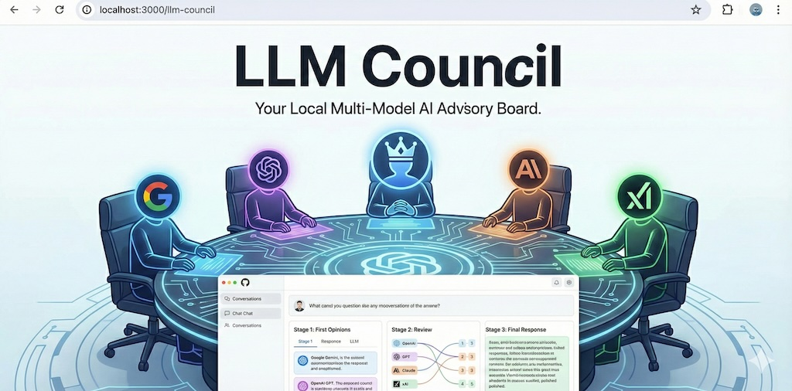

# FortiAICouncil



FortiAICouncil is a fork of Andrej Karpathy's [LLM Council](https://github.com/karpathy/llm-council), reworked to run on a [Bifrost](https://github.com/maximhq/bifrost) gateway instead of OpenRouter.

It is a local ChatGPT-style web app that sends your question to several LLMs, has them anonymously review and rank each other's answers, and has a Chairman model write the final response.

Added on top of the original:
- Bifrost gateway support with `provider/model` IDs and virtual keys.
- Upload a `SKILL.md` or LLM-wiki pages (`.md`, `.txt`) in the sidebar; they are added to every stage's prompt as reference material.
- Delete conversations from the sidebar.
- Conversation titles generated by a small Bifrost model (`TITLE_MODEL` in `backend/config.py`).

## Why an LLM council?

A single LLM tends to be too accommodating. It agrees with the premise of your question, validates your plan, softens criticism, and rarely pushes back. That is sycophancy, and it is hardest to spot when you most need a straight answer.

A council counters this in three ways:

- **Independent opinions.** Each model answers on its own, so you see where they agree and where they diverge. A confident answer that no other model supports stands out.
- **Anonymized peer review.** In Stage 2 models rank "Response A, B, C…" without knowing who wrote what, or that one of them is their own. They can't defer to a famous name or flatter themselves, and a flattering but weak answer can lose to a blunt, correct one.
- **A synthesizing Chairman.** The final answer is built from the full set of answers and critiques rather than from one model's first instinct.

It costs more tokens and takes longer than a single call. Use it for questions where being wrong, or being flattered, is expensive.

## How it works

1. **Stage 1: First opinions.** Your query goes to every council model in parallel. Responses appear in tabs so you can read each one.
2. **Stage 2: Peer review.** Each model sees the other responses with identities anonymized, evaluates them, and ends with a strict `FINAL RANKING:` list. The app de-anonymizes on the client and shows the parsed ranking under each raw evaluation so you can verify the parsing. Aggregate rankings show average position across all reviewers.
3. **Stage 3: Final answer.** The Chairman model synthesizes the answers and rankings into one response.

If a model fails, the council continues with the rest.

## What's different from the OpenRouter version

| | OpenRouter original | This fork (Bifrost) |
|---|---|---|
| Endpoint | one full URL | `BIFROST_API_URL` base, default `https://bifrost.fabriclab.ca/openai/v1`; `/chat/completions` is appended |
| Key | `OPENROUTER_API_KEY` (`sk-or-…`) | Bifrost virtual key (`sk-bf-…`) from `ANTHROPIC_AUTH_TOKEN` or `BIFROST_API_KEY` |
| Auth headers | `Authorization: Bearer` | `Authorization: Bearer` and `x-bf-vk` |
| Model IDs | OpenRouter slugs (`openai/gpt-5.1`) | Bifrost `provider/model` (`azure/gpt-5.5`, `vllm/qwen3-8-27b-local`) |
| Client module | `backend/openrouter.py` | `backend/bifrost.py` |

The council logic in `backend/council.py` is unchanged.

## Setup

Requires Python 3.10+, [uv](https://docs.astral.sh/uv/), and Node.js.

```bash
uv sync
cd frontend && npm install && cd ..
```

### Configure Bifrost

Create `.env` in the project root:

```bash
BIFROST_API_KEY=sk-bf-...
BIFROST_API_URL=https://bifrost.fabriclab.ca/openai/v1
```

Rules for the key line: one `=`, no quotes, no spaces. `.env` is a secret, so keep it out of git. If you already export `ANTHROPIC_AUTH_TOKEN` for Claude Code, the app uses it first.

Get a virtual key from your Bifrost admin. Keep `BIFROST_API_URL` on the `/openai/v1` route; the `/anthropic` route used by Claude Code uses a different request format.

### Configure the council

Edit `backend/config.py`:

```python
COUNCIL_MODELS = [
    "vllm/qwen3-8-27b-local",
    "vllm/qwen3-8-flash-next-ant",
    "azure/glm-5.2",
    "azure/gpt-oss-120b",
]

CHAIRMAN_MODEL = "azure/gpt-5.5"
```

Use distinct models: results are keyed by model name, so duplicates collapse into one response. Model IDs must exist in your Bifrost; an unknown ID returns 404 and that member is skipped.

### Check connectivity

```bash
curl -s "$BIFROST_API_URL/chat/completions" \
  -H "Authorization: Bearer $BIFROST_API_KEY" \
  -H "x-bf-vk: $BIFROST_API_KEY" \
  -H "Content-Type: application/json" \
  -d '{"model":"azure/gpt-5.5","messages":[{"role":"user","content":"hi"}]}'
```

## Run

```bash
./start.sh
```

Or manually:

```bash
uv run python -m backend.main        # backend on :8001
cd frontend && npm run dev           # frontend on :5173
```

Open http://localhost:5173.

## Troubleshooting

| Symptom | Cause |
|---|---|
| `Unable to generate final synthesis` | The Chairman call failed. Run the curl check above with the Chairman model. |
| `401 virtual_key_required` | No key loaded. Check `.env` is in the project root and the variable name. |
| `401 access_not_found` | The key is malformed (stray quotes or `=`) or revoked. |
| `404` for one model | That model ID isn't served by your Bifrost. |

## Tech stack

- **Backend:** FastAPI, async httpx, Bifrost gateway
- **Frontend:** React + Vite, react-markdown
- **Storage:** JSON files in `data/conversations/`
- **Packaging:** uv (Python), npm (JavaScript)

## Notes

Like the original, this is a lightly maintained prototype, provided as is.
